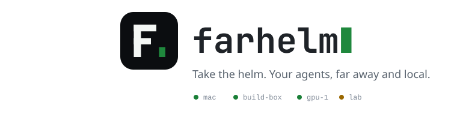
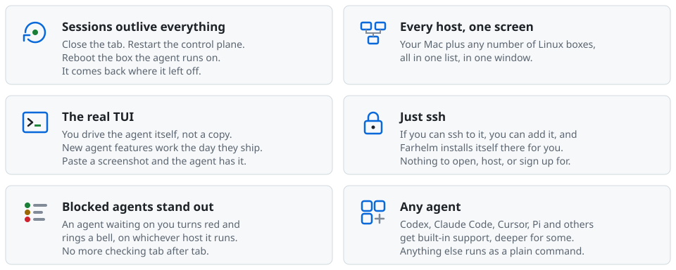
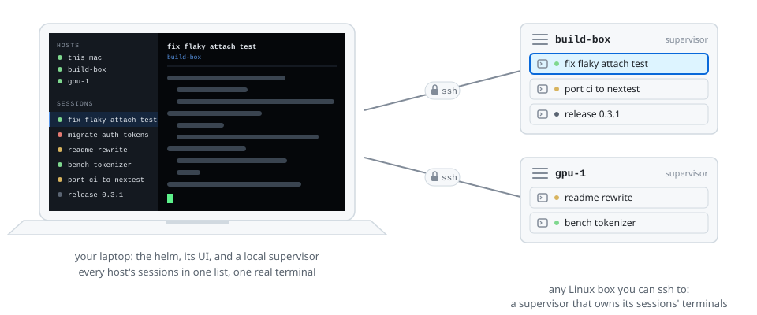
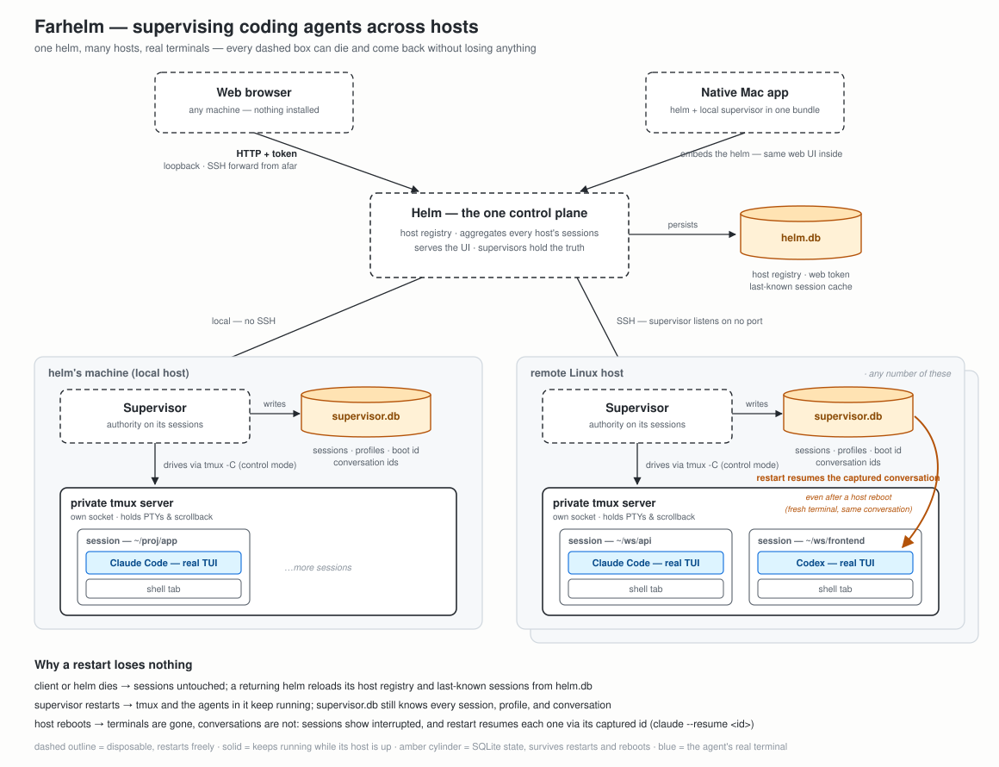

<!-- The header, the pillars, and the how-it-works drawing are SVG files rendered by website/scripts/render-svgs.mjs; edit
     that script and re-run it rather than the SVGs. They belong to the docs website, whose landing page shows the same
     introduction, and this file borrows them from there. GitHub shows an SVG only through , which cannot see
     the page's colour scheme, so each block is two files picked by a <picture> media query. -->

  <picture>
    <source media="(prefers-color-scheme: dark)" srcset="website/src/assets/intro/header-dark.svg">
    
  </picture>

  
  
  

  One window for every coding agent you run, on your Mac and on any Linux box you can ssh to. Each agent keeps
  running on its machine when you close the lid, and you pick it up where it was.

<!-- The image below is a real capture of the web UI against a staged fleet, regenerated by
     scripts/readme-screenshot.sh and published by scripts/publish-readme-hero.sh, which rewrites
     the URL inside the markers below, and the same URL on the docs website's landing page.
     See docs/readme-hero/SPEC.md. Do not edit the URL by hand.
     The markers wrap the whole image line rather than sitting inside its parens: a comment placed
     inside a link destination becomes part of the URL instead of being hidden, which is what broke
     this image the first time around. -->
<!-- readme-hero-url -->

<!-- /readme-hero-url -->

  Seven sessions across three hosts. The mark on each row says what that agent is doing: working,
    waiting for you, or finished since you last looked.

  <picture>
    <source media="(prefers-color-scheme: dark)" srcset="website/src/assets/intro/pillars-dark.svg">
    
  </picture>

## Why should I use it?

- **The agent's own TUI.** You drive the real Claude Code, Codex, or whatever you run, keystroke for keystroke, not a
  wrapper around it.
- **Screenshots and files.** Paste or drop one into the terminal and the agent has it, even when the agent runs on a
  machine across the network.
- **Downloads.** When the agent mentions a file it made, hover over the path and click to download it.
- **Nothing loses its place.** Close the laptop, restart Farhelm, reboot the remote host: every session is still in the
  list, and restarting it picks the agent's conversation back up.
- **Templates.** Often start Codex in YOLO mode on a checkout of `acme/web` on `build-box`? Save that as a launch
  template, then in the Mac app press Cmd+N, type `tl:web`, and press Enter twice: once to apply it, once to launch.
- **Change one thing.** Want this session again, but with Codex instead of Claude? **clone** opens the launcher with
  everything already filled in, so you change just the agent and launch. **replace with** does the same, and swaps the
  new session in for this one.
- **Agents start sessions.** Tell your agent
  `$farhelm for each of the TODO items above, start a session in a new managed checkout of acme/web, named after the item`,
  and it will. Farhelm asks you before each one starts, unless you have told it to trust that host.
- **Version control.** Farhelm works in any directory, whatever it uses for version control. It can also manage
  checkouts of your GitHub repositories: a fresh clone for each session, moved to the trash when you are done with it.

## How it works

  <picture>
    <source media="(prefers-color-scheme: dark)" srcset="website/src/assets/intro/how-it-works-dark.svg">
    
  </picture>

Farhelm has two parts. The **helm** is what you look at, usually the Farhelm app on your Mac: it keeps your list of
hosts and shows every session. A **supervisor** runs on each machine, your Mac included, and keeps that machine's agents
and their terminals running. The helm reaches each supervisor over SSH. Nothing listens on a network port, nothing goes
through a relay, and every box in the diagram can restart without losing a session.

More details (architecture diagram)

## Docs and installation

See [farhelm.io](https://farhelm.io) for documentation and installation instructions.
